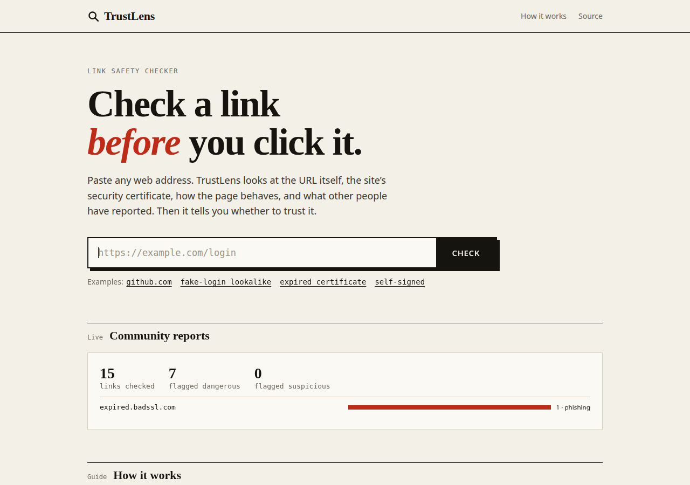
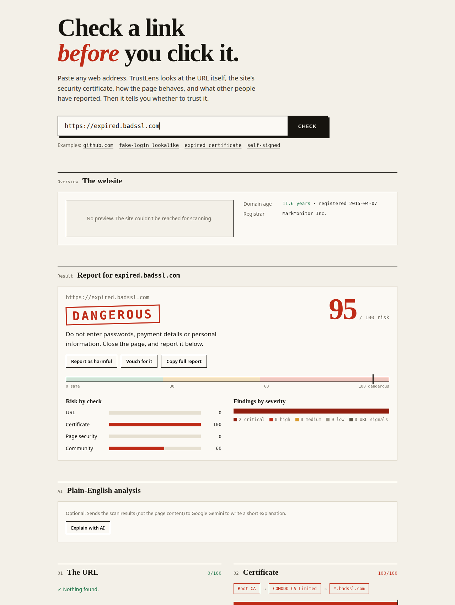
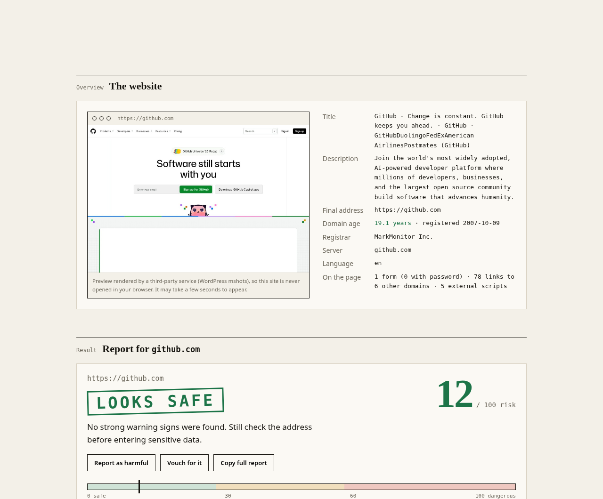
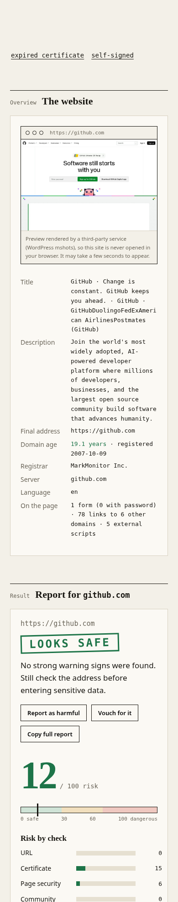

# TrustLens

**Check a link before you click it.**

Paste any web address and TrustLens tells you whether it looks safe, in plain language. It checks the link from four angles and combines them into one risk score from 0 (safe) to 100 (dangerous).

**Live demo:** https://mavrick-1.github.io/trustlens/



## What it checks

| Check | What it looks for |
|---|---|
| **The URL** | Lookalike brand names (like `paypa1-login.com`), odd domains, tricks used to hide the real address |
| **The certificate** | Expired or self-signed certificates, broken trust chains, weak keys, and a watchlist of risky certificate issuers (for example the eMudhra incident). Also checks Certificate Transparency logs |
| **The page** | Missing security headers, risky cookies, hidden or password forms, suspicious redirects |
| **The community** | Reports from other people. Anyone can mark a site as harmful or vouch for it |

It also shows a **preview of the site**, how **old the domain is**, and who registered it. Brand new domains are a common sign of phishing, so a very young domain raises the score.

## What you see

A dangerous example, an expired certificate:



A safe example, github.com:



It works on phones too:



## Optional AI explanation

After a scan, press **Explain with AI**. Google Gemini writes a short plain-English summary of the results. A few things to know:

- It only runs when you press the button.
- It gets the scan results, not the page content.
- It is advice only and never changes the score.
- It needs a `GEMINI_API_KEY` on the server. Without one, the button says it isn't enabled.

## Run it on your computer

You only need Python 3. There is nothing to install.

```bash
git clone https://github.com/MAVRICK-1/trustlens.git
cd trustlens
python3 server.py
```

Open http://localhost:8000. To turn on the AI button:

```bash
GEMINI_API_KEY=your-key python3 server.py
```

You can also open a scan directly: `http://localhost:8000/?url=https://github.com`

## How it is put together

```
static/index.html      the whole website (HTML, CSS, JavaScript in one file)
server.py              the small web server and API
trustlens/
  urlintel.py          URL and lookalike checks
  certcheck.py         certificate and Certificate Transparency checks
  websec.py            page fetch, security headers, page overview
  rdap.py              domain age and registrar
  intel.py             community reports (SQLite)
  ai.py                optional Gemini explanation
```

The website is hosted on **GitHub Pages**. The server runs on **Render** using the `Dockerfile`.

### API

| Endpoint | What it does |
|---|---|
| `GET /api/scan?url=...` | Full scan and risk score |
| `GET /api/explain?url=...` | AI explanation (needs `GEMINI_API_KEY`) |
| `POST /api/report` | Report a site as harmful or safe |
| `GET /api/feed` | Recent community activity |
| `GET /api/health` | Is the server up |

## Deploy your own

**Frontend (GitHub Pages).** The workflow in `.github/workflows/pages.yml` publishes the `static/` folder when you push to `main`. In `static/index.html`, set `DEFAULT_API` to your server's address.

**Backend (Render).** Create a Web Service from this repo and choose Docker. Then add these under **Environment**:

| Variable | Value |
|---|---|
| `ALLOWED_ORIGIN` | Your Pages address, for example `https://mavrick-1.github.io` |
| `GEMINI_API_KEY` | Your Gemini key (optional, for the AI button) |

Never put the key in the website code or commit it to git.

The free Render plan sleeps when idle, so the first scan after a break can take up to a minute. It also forgets community reports when it restarts, because they are stored in a local SQLite file.

## Safety and limits

- The scanner refuses private and internal addresses, and checks every redirect, so it can't be tricked into probing a private network.
- The site preview comes from a third-party service (WordPress mshots). The scanned address is sent to it, and the site is never opened in your browser.
- A low score is a good sign, not a guarantee. Always check the address before entering passwords or payment details.
- Domain age isn't available for every domain type, so some show "unknown".
